<h1 align="center">Hi 👋, I'm Hans</h1>
<h3 align="center">A full-stack developer from Taiwan</h3>

<h3 align="left">Connect with me:</h3>

<h3 align="left">Languages and Tools:</h3>

  
  
  
  
  
  
  
  
  
  
  
  
  

&nbsp;

